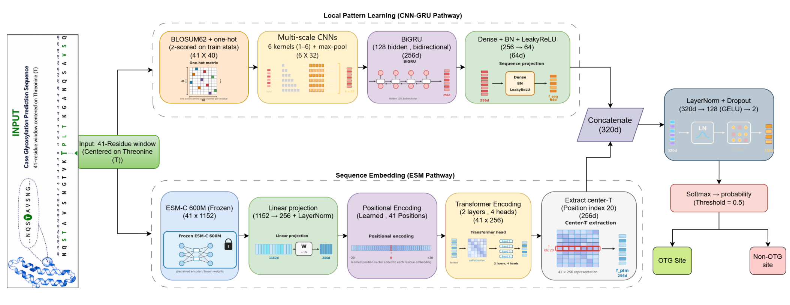
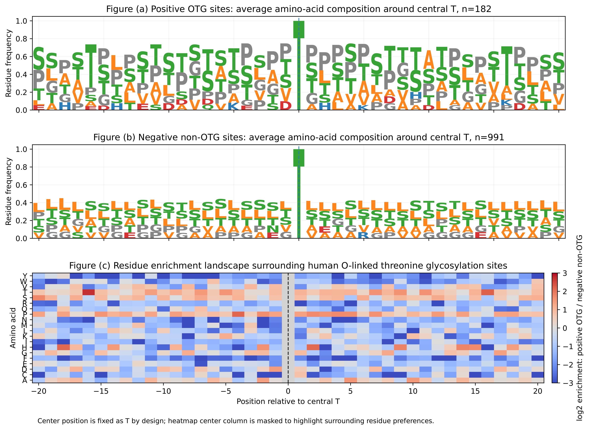
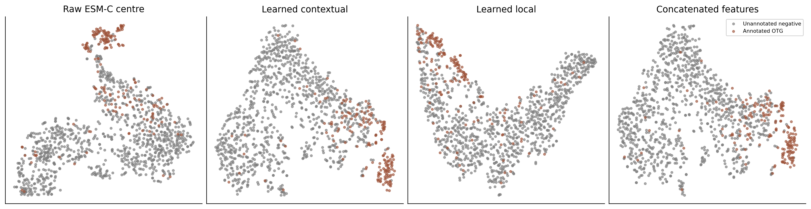

# ESMC-OTG

**Protein language model-guided multi-scale deep learning for identification of human O-linked threonine glycosylation sites**

[](https://colab.research.google.com/github/Offpass/ESMC_OTG_Prediction/blob/main/ESMC_OTG.ipynb)

ESMC-OTG predicts whether a threonine in a human protein is an O-linked glycosylation (OTG) site. It reads a 41-residue window centred on the candidate threonine and combines two views of it: contextual embeddings from the ESM-C protein language model, and local sequence patterns learned from BLOSUM62 and one-hot encodings.



## Contents

- [Model](#model)
- [Data](#data)
- [Results](#results)
- [Interpretability](#interpretability)
- [Training settings](#training-settings)
- [Running the code](#running-the-code)
- [Repository structure](#repository-structure)
- [Citation](#citation)

## Model

ESMC-OTG has two branches whose outputs are concatenated and classified together.

| Branch | Input | Architecture | Output |
|---|---|---|---|
| Contextual | Frozen ESM-C 600M residue embeddings (1,152-d), via [`Synthyra/ESMplusplus_large`](https://huggingface.co/Synthyra/ESMplusplus_large) | Linear projection to 256 + LayerNorm, learned positional embeddings, 2-layer transformer encoder (4 heads), centre-residue representation | 256-d |
| Local | One-hot (20) + z-scored BLOSUM62 (20) per residue | Six parallel 1-D convolutions (kernel sizes 1-6, 32 channels), max pooling, bidirectional GRU (128 per direction), projection with batch normalization | 64-d |
| Classifier | Concatenated 320-d vector | LayerNorm, dropout, 128-unit GELU layer, 2-class softmax | OTG probability |

Training uses stratified five-fold cross-validation repeated with seven random seeds (42-48). The five fold models of each seed are averaged into a seed ensemble, and a site is predicted as OTG when its probability is at least 0.5.

## Data

The benchmark comes from Tang et al. (2023, O-GlyThr): experimentally verified human OTG sites from UniProt, with proteins filtered by CD-HIT at 40% identity. Each sample is a 41-residue window (20 upstream, central threonine, 20 downstream). Negatives are threonines in the same proteins without a glycosylation annotation.

| Split | Positive | Negative | Total | File |
|---|---:|---:|---:|---|
| Training | 879 | 878 | 1,757 | `data/pos_train.fa`, `data/neg_train.fa` |
| Balanced test | 200 | 200 | 400 | `data/pos_test.fa`, `data/neg_test.fa` |
| Imbalanced test | 182 | 991 | 1,173 | `data/Imbalanced_Independent.txt` |

The balanced test contains 19 windows that also occur in the training files. The imbalanced test has no exact training overlaps; its 182 positives are the balanced-test positives without those duplicates.

## Results

### Comparison with existing predictors

Values reported in the manuscript (threshold 0.5).

**Balanced test (200 positive / 200 negative)**

| Method | MCC | SEN | SPE | ACC |
|---|---:|---:|---:|---:|
| **ESMC-OTG (this work)** | **0.832** | 0.880 | **0.950** | **0.915** |
| DeepO-GlyThr † | 0.800 | **0.885** | 0.915 | 0.900 |
| DOGpred (Lee et al., 2025) | 0.771 | 0.855 | 0.915 | 0.885 |
| HOTGpred (Pham et al., 2024) | 0.767 | 0.845 | 0.920 | 0.882 |
| O-GlyThr (Tang et al., 2023) | 0.702 | 0.815 | 0.885 | 0.850 |
| NetOGlyc-4.0 (Steentoft et al., 2013) | 0.645 | 0.823 | 0.810 | 0.835 |

**Imbalanced test (182 positive / 991 negative)**

| Method | MCC | SEN | SPE | ACC |
|---|---:|---:|---:|---:|
| **ESMC-OTG (this work)** | **0.695** | 0.868 | **0.912** | **0.905** |
| DeepO-GlyThr † | 0.643 | **0.874** | 0.881 | 0.880 |
| DOGpred (Lee et al., 2025) | 0.646 | 0.841 | 0.896 | 0.888 |
| HOTGpred (Pham et al., 2024) | 0.638 | 0.845 | 0.884 | 0.877 |
| O-GlyThr (Tang et al., 2023) | 0.689 | 0.815 | 0.873 | 0.844 |
| NetOGlyc-4.0 (Steentoft et al., 2013) | 0.535 | 0.828 | 0.810 | 0.831 |

† Measured by running the authors' released [DeepO-GlyThr](https://github.com/TangQiang0701/DeepO-GlyThr) model (commit `8e94f09`) with its own encoder on exactly the same test windows ([`results/deepoglythr_comparison.csv`](results/deepoglythr_comparison.csv)). Other comparator values are quoted from their publications.

### Seven-seed summary

Running [`ESMC_OTG.ipynb`](ESMC_OTG.ipynb) trains all seven seeds and reports the mean ± standard deviation of the seed ensembles, saved in [`results/main_metrics.csv`](results/main_metrics.csv):

| Test set | MCC | Accuracy | Sensitivity | Specificity |
|---|---:|---:|---:|---:|
| Balanced test | 0.818 ± 0.011 | 0.908 ± 0.005 | 0.877 ± 0.015 | 0.939 ± 0.020 |
| Imbalanced test | 0.691 ± 0.027 | 0.903 ± 0.014 | 0.865 ± 0.017 | 0.910 ± 0.019 |

Exact values vary slightly between runs because of GPU non-determinism and library versions.

### Ablation (imbalanced test)

| Model | MCC | ACC | SEN | SPE |
|---|---:|---:|---:|---:|
| ESM-C only (single branch) | 0.642 | 0.878 | 0.879 | 0.878 |
| Dual branch, no Mixup/SWA | 0.666 | 0.890 | 0.879 | 0.892 |
| Fine-tuned ESM-C (single branch) | 0.668 | 0.887 | 0.901 | 0.884 |
| **Full model (ESMC-OTG)** | **0.695** | **0.905** | 0.868 | **0.912** |

The ablation notebooks are in [`notebooks/ablations`](notebooks/ablations).

## Interpretability

### Residue preferences around OTG sites



OTG windows are rich in serine, threonine and proline, especially upstream of the site. Proline is enriched immediately around the acceptor threonine, matching the known substrate preference of polypeptide GalNAc-transferases. The strongest single signal is threonine 16 residues upstream of the site (88 of 182 OTG windows versus 69 of 991 negatives). Many positive windows come from tandem-repeat, mucin-like segments in which neighbouring repeat units are also glycosylated, consistent with the lectin-domain-guided glycosylation of nearby sites by GalNAc-transferases.

### Learned representations



t-SNE of the 1,173 imbalanced-test windows in four representations from one trained model. Raw ESM-C embeddings overlap strongly between classes; after training, the contextual and fused representations separate them clearly.

| Representation | Dimensions | Silhouette score |
|---|---:|---:|
| Raw ESM-C centre embedding | 1,152 | 0.040 |
| Learned contextual (ESM-C branch) | 256 | 0.355 |
| Learned local (CNN-BiGRU branch) | 64 | 0.097 |
| Fused | 320 | 0.351 |

## Training settings

| Setting | Value |
|---|---|
| Optimizer | AdamW, learning rate 3e-4, weight decay 5e-4 |
| Batch size | 64 |
| Maximum epochs | 100 |
| Early stopping | Validation MCC at threshold 0.5, patience 10, best epoch restored |
| Dropout | 0.3 (transformer, local projection, classifier) |
| Gradient clipping | 1.0 |
| Mixup | alpha 0.2, within each batch |
| Label smoothing | 0.1 |
| Stochastic weight averaging | 10 SGD epochs (momentum 0.9), cosine learning rate 3e-4 to 6e-5; kept only if validation MCC does not drop |
| Cross-validation | Stratified 5-fold, seeds 42-48 |
| Decision threshold | 0.5 |
| ESM-C embeddings | Frozen, extracted once in evaluation mode with bfloat16 autocast |

## Running the code

**Colab:** click the badge at the top. The notebook downloads the data automatically when it is not found locally.

**Locally:**

```bash
git clone https://github.com/Offpass/ESMC_OTG_Prediction.git
cd ESMC_OTG_Prediction
pip install -r requirements.txt
jupyter notebook ESMC_OTG.ipynb
```

Install a PyTorch build that matches your CUDA driver. An NVIDIA GPU is recommended; the frozen-embedding model trains in under a minute per seed on a modern GPU once embeddings are extracted. Set `OTG_DATA_DIR` to use data stored outside the repository. Results are written to `outputs/esmc_otg/results.json`.

## Repository structure

```text
ESMC_OTG_Prediction/
├── ESMC_OTG.ipynb                 main notebook: data, embeddings, training, evaluation
├── requirements.txt
├── data/                          training, balanced and imbalanced test sets
├── figures/
│   ├── pipeline.png               model overview
│   ├── amino_acid_landscape.*     residue composition and enrichment
│   └── representation_tsne.*      t-SNE of raw, contextual, local and fused features
├── notebooks/ablations/           ESM-C only, dual branch without Mixup/SWA, fine-tuned ESM-C
└── results/
    ├── main_metrics.csv           seven-seed mean and standard deviation
    └── deepoglythr_comparison.csv same-sample comparison with DeepO-GlyThr
```

## Citation

Alblooshi M. S., Abbas Z., and Rehman M. U. ESMC-OTG: Protein Language Model-Guided Multi-Scale Deep Learning for Identification of Human O-Linked Threonine Glycosylation Sites. *Frontiers in Cell and Developmental Biology* (under review).

The benchmark dataset is from Tang H., Tang Q., Zhang Q., and Feng P. O-GlyThr: prediction of human O-linked threonine glycosites using multi-feature fusion. *International Journal of Biological Macromolecules* 242, 124761 (2023).

## Contact

Mobeen Ur Rehman (corresponding author), United Arab Emirates University: mobeen.rehman@uaeu.ac.ae
